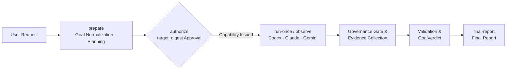

# VibeMarshal

[한국어](README.md) | **[English](README.en.md)**

**VibeMarshal** is a local **Workflow Orchestrator** that normalizes large software engineering requests into verifiable Goal Contracts (`GoalContractRevision`) and dependency-aware Task DAGs, tracking planning, execution, observation, validation, and recovery across AI agent runtimes in a single authoritative SQLite ledger (schema 4).

The product name is **VibeMarshal**, while the technical identifiers for the Python package and CLI entrypoint are `FlowMarshal` and `flowmarshal-engine`.

> [!NOTE]
> **Release & Qualification Status (`v1.0.0` Package Release / Full Live Qualification Campaign Notes)**
> - **Implemented Scope:** The user CLI façade (`flowmarshal-engine 1.0.0`), SQLite schema 4 single ledger, `RuntimeJob` lifecycle supervisor, three runtime providers (`codex`, `claude`, `gemini` including the Antigravity `agy_gemini_bridge.py` adapter), the `agent-governance-suite` workflow gate, and the local HTTP/SSE Engine API (`http_api.py`) for the desktop GUI (`apps/desktop`) are implemented and verified.
> - **1.0 Qualification Boundary:** The deterministic test suite (138 test modules), Synthetic Smoke lifecycle, Wheel packaging isolation, Desktop GUI tests & build, and live Antigravity Gemini CLI (`agy.exe`) end-to-end verification have all passed. Full multi-seed live evaluation campaigns (48 role evaluations, 18 planning evaluations, 16 project E2E cells) remain reproducible via the dedicated evaluation harness (`eval_cli.py`), and `apps/desktop` supports both synthetic Mock mode and live Local HTTP Engine mode.

---

## What VibeMarshal Solves & Architecture

Rather than trusting an AI model's self-reported completion claims or implicit state mutations, VibeMarshal governs engineering workflows through **explicit contracts, verifiable evidence, and deterministic ledger transitions**.

- **Goal Contract Normalization & Independent Review:** Normalizes raw user requests into a strict `GoalContractRevision` (Hard ACs, constraints, non-goals, effect policy) and binds independent review findings into the preparation record.
- **Skeleton-First Planning & Task DAG:** Establishes high-level strategy skeletons before committing to concrete file paths or commands, producing an executable `PlanContractRevision` and dependency-aware Task DAG.
- **Human Authorization Boundary & Automatic Plan Activation:** Users authorize the goal scope, allowed effects, and operational policies via `GoalAuthorization`; the Core then automatically activates a compliant immutable Plan revision within that boundary.
- **Just-in-Time Materialization & Freshness Checks:** Materializes a `TaskExecutionSpecRevision` only when a Task's dependencies are satisfied (`ready`), re-verifying input freshness and target bindings immediately before any real effect occurs.
- **Multi-Runtime Execution & Provenance-Bound Ledger:** Records execution intents, receipts, thread/turn bindings, provenance-separated usage metrics, and `EvidenceRecord` entries across Codex App Server, Claude Code CLI, and Gemini CLI in SQLite.
- **Evidence-Based Verdict:** Determines Task and Goal completion strictly through deterministic checks, independent semantic validation (`ValidationResult`), and `GoalVerdict`—never from a model's conversational declaration.
- **Observe-First Recovery & Bounded Replanning:** Handles interruption, resumption, failure classification, and bounded repair/replanning strictly from ledger state and direct evidence.



The authoritative implementation lives in `flowmarshal.engine`. Earlier R1–R3.1 and `threadkeeper` code is preserved solely as an auditable `legacy/prototype` baseline and is never imported into the new Engine domain.

### Authoritative Domain Objects

| Authoritative Object | What It Freezes |
|---|---|
| `ProjectProfileRevision` | Long-term project purpose, compatibility rules, default validation, and risk policy |
| `GoalContractRevision` | Original user prompt, observations, Hard ACs, Soft preferences, constraints, non-goals, effect policy, and preparation binding |
| `StateSnapshot` / `ProjectMapRevision` | Goal-scoped facts, evidence, freshness invalidation conditions, and indexed files, `AGENTS.md` chains, and observed symbols |
| `PlanSkeletonCandidate` / `PlanContractRevision` | Pre-command strategy skeleton, Goal/State bindings, Task DAG, AC links, validation/recovery policies, and role model assignments |
| `TaskExecutionSpecRevision` | Ready-time file paths, symbols, commands, Context Pack, locks, timeouts, idempotency rules, and model bindings |
| `Attempt` · `EvidenceRecord` · `GoalVerdict` | Execution/validation attempts, external effect receipts, observed evidence, final Goal verdict, and measured usage (`BudgetUsageRecord`) |

---

## Installation

Python 3.10 or higher is required. Install the prerelease wheel into an isolated virtual environment (separate from the source checkout) using absolute paths:

```powershell
python -m venv C:\absolute\flowmarshal-venv
C:\absolute\flowmarshal-venv\Scripts\python.exe -m pip install `
  C:\absolute\dist\flowmarshal_engine-1.0.0-py3-none-any.whl
C:\absolute\flowmarshal-venv\Scripts\flowmarshal-engine.exe --help
```

This installation example does not imply completion of 1.0 qualification. See the [Engine Package Installation Contract](docs/engine-package-install.md) for wheel boundaries and pinned dependencies.

---

## Quickstart Workflow

You can start from a wheel-only environment without needing the repository's `config/` directory.

### Step 1: Initialize Role Configuration & Project

Define absolute paths for the state directory and target project root, then initialize the role configuration using a `model` and `effort` supported by your runtime provider's inventory (Codex `model/list`, or a Claude/Gemini model catalog):

```powershell
$ProjectRoot = (Resolve-Path "C:\path\to\my-project").Path
$StateRoot = (New-Item -ItemType Directory -Force (Join-Path $ProjectRoot ".flowmarshal-engine")).FullName
$Database = Join-Path $StateRoot "flowmarshal-engine.sqlite3"
$Artifacts = Join-Path $StateRoot "artifacts"
$RoleConfig = Join-Path $StateRoot "roles.json"
$VibeMarshal = "C:\absolute\flowmarshal-venv\Scripts\flowmarshal-engine.exe"

& $VibeMarshal config init `
  --output $RoleConfig `
  --model "<model-id>" `
  --effort high

& $VibeMarshal --db $Database --artifacts $Artifacts project init `
  --name "my-project" `
  --root $ProjectRoot
```

- `config init` applies the specified model and effort across all seven engine roles (`goal_normalizer`, `goal_reviewer`, `planner`, `general_reviewer`, `critical_reviewer`, `worker`, `validator`) and validates them against the active model inventory before writing the file.
- To override an individual role, append `--role "validator=<model-id>:<effort>"`. Existing files are never overwritten, and the package does not impose a universal default model.

### Step 2: Prepare (`prepare`), Authorize (`authorize`), and Run First Tick (`run-once`)

Use the `project_id` emitted by `project init` to prepare and authorize your request, then execute the first bounded scheduler tick:

```powershell
& $VibeMarshal --db $Database --artifacts $Artifacts prepare `
  --project-id <project-id> `
  --request "Update both modules and run the regression test suite." `
  --role-config $RoleConfig

& $VibeMarshal --db $Database --artifacts $Artifacts authorize `
  --project-id <project-id>

& $VibeMarshal --db $Database --artifacts $Artifacts run-once `
  --project-id <project-id> `
  --role-config $RoleConfig
```

> [!IMPORTANT]
> **Interactive Authorization Boundary (`TrustedConsoleHost` & `target_digest`)**
> - The installed `flowmarshal-engine` CLI displays the authorization target through `TrustedConsoleHost`.
> - `authorize` prints the current Goal, `project_root`, the selected Plan's identity, revision, definition/activation digests, effect policy, operational policy, budget policy, and the full **`target_digest`**.
> - You must **enter the exact `target_digest` string in the interactive console** for the in-process `ApplicationAuthority` to issue a one-time capability token. You do not need to manually copy or assemble internal Plan IDs.
> - The Core recomputes the latest target (including the selected Plan) immediately before writing to the ledger; any mismatched input, EOF, non-interactive invocation, or post-display change to Goal/root/policy/Plan aborts without recording authorization. `--source` is an audit label only and grants no authority.
> - This process-local boundary does not isolate hostile same-process code, and raw SQLite writes by same-OS-user subprocesses without OS/broker isolation remain a known 1.0 limitation. See [Authorization Contract D02](docs/redesign-1.0-contract.md) for details.

### Step 3: Observe-First Loop (`status` / `observe`) & Final Report (`final-report`)

`run-once` performs at most one state transition or schedules/consumes a `RuntimeJob` and returns promptly. On subsequent ticks, inspect `status` first and call `observe` whenever an active provider job is running:

```powershell
& $VibeMarshal --db $Database --artifacts $Artifacts status --project-id <project-id>
& $VibeMarshal --db $Database --artifacts $Artifacts observe --project-id <project-id>
& $VibeMarshal --db $Database --artifacts $Artifacts run-once --project-id <project-id> --role-config $RoleConfig
& $VibeMarshal --db $Database --artifacts $Artifacts final-report --project-id <project-id> --format markdown
```

- The number of ticks required to reach a `GoalVerdict` depends on the Plan DAG and ledger state.
- Iterative execution and observe-first recovery follow the [Engine User Workflow](docs/engine-user-workflow.md), including its guide on [Reading Automatic Recovery State](docs/engine-user-workflow.md#자동-복구-읽기).
- Observed token stop policies (`project budget set`) are optional user-managed files that act only as best-effort stop thresholds based on provider-observed tokens—never as exact billing calculators or subscription quota predictors. `call_reservation_tokens` is a deprecated compatibility field and is excluded from admission calculations.

---

## User CLI Reference

### Top-Level Façade & Governance Commands

| Command | Responsibility |
|---|---|
| `config init` | Validate explicit `model`/`effort` bindings against the inventory and write a user-owned role configuration JSON |
| `prepare` | Normalize the user request, perform independent Goal review, and run Skeleton-first Planning |
| `revise` | Incorporate preparation feedback or constraint updates into a new Goal/Plan revision |
| `authorize` | Approve goal scope and operational policy via interactive `target_digest` confirmation and activate a compliant Plan |
| `run-once` | Execute a single bounded scheduler tick |
| `observe` | Observe an active provider `RuntimeJob` and record receipts/terminal state |
| `pause` | Pause the active Goal workflow |
| `cancel` | Cancel the active Goal workflow |
| `replan` | Trigger bounded replanning while protecting in-flight Attempts and verified evidence |
| `status` | Query Core, control, active job, and recovery state |
| `final-report` | Render the final report backed by `GoalVerdict`, validation evidence, and observed usage |
| `governance check-plugin` | Run a standalone conformance check against an `agent-governance-suite` plugin root |

Nested diagnostic and operational subcommands are available under `project`, `model`, `goal`, `plan`, `task`, `run`, `attempt`, `validate`, `recover`, and `report`. Run `flowmarshal-engine --help` or `<subcommand> --help` for full details.

---

## Runtime Providers (Codex · Claude · Gemini)

The default runtime provider for role and Worker invocations is **Codex App Server**. You can explicitly select **Claude Code CLI** (`--provider claude`) or **Gemini CLI** (`--provider gemini`) using global flags placed before the subcommand. **Automatic fallback between providers is strictly prohibited (fail-closed).**

| Provider | Global Flag | Model Catalog / Inventory | Binary Flag | Highlights |
|---|---|---|---|---|
| **Codex App Server** *(Default)* | `--provider codex` *(optional)* | Live Codex `model/list` query | `--codex-bin` *(optional)* | Enforces `:danger-full-access` & `approval_policy=never` |
| **Claude Code CLI** | `--provider claude` | `--claude-model-catalog <json>` *(required)* | `--claude-bin <exe>` | Runs in `--safe-mode`; rejects `.cmd`/`.bat`/`.ps1` shims |
| **Gemini CLI / Antigravity** | `--provider gemini` | `--gemini-model-catalog <json>` *(required)* | `--gemini-bin <exe\|py>` | Supports standard Gemini CLI and `agy_gemini_bridge.py` (`agy.exe`) |

### 1. Claude Code Runtime Provider (`--provider claude`)

To use Claude Code CLI, supply `--provider claude` along with a model/effort catalog:

```powershell
flowmarshal-engine --provider claude `
  --claude-model-catalog D:\config\claude-model-catalog.json `
  --claude-bin C:\Users\<user>\.local\bin\claude.exe `
  <subcommand> ...
```

- **Catalog Binding:** The catalog (`flowmarshal-claude-model-catalog-v1`) replaces `model/list` as a user-owned configuration and is bound to the run metadata as `configured_catalog` along with its SHA-256 digest. See [`config/claude-model-catalog.json`](config/claude-model-catalog.json) and [`config/qualification-roles.claude.json`](config/qualification-roles.claude.json) for examples.
- **Executable Pinning:** `--claude-bin` must point to a real executable binary; `.cmd`, `.bat`, and `.ps1` shims are rejected. Both the binary SHA-256 digest and `claude --version` output are pinned, requiring a new binding when the CLI is upgraded.
- **Session Isolation:** Child sessions run with `--safe-mode` so they do not inherit user `CLAUDE.md`, auto-memory, plugins, hooks, or MCP servers. Project `AGENTS.md` files are injected directly into the Context Pack by the Engine.
- **Permission & Provenance Rules:** `:danger-full-access`/`never` is mapped locally from Claude's `bypassPermissions` observation, and any turn reporting `permission_denials` fails immediately. Because stream output omits effort, `observed_model` and `observed_effort` are recorded under `claude_session_transcript` provenance only when the saved session transcript's assistant entry for that exact turn specifies a single unambiguous pair; otherwise they remain `null`. See [Orchestration Redesign §7.2](docs/orchestration-redesign.md#72-claude-code-runtime-provider).

### 2. Gemini CLI & Antigravity Bridge Provider (`--provider gemini`)

To run roles and Workers through Gemini CLI or the local Antigravity bridge (`agy.exe`), pass `--provider gemini` and a Gemini model catalog (`flowmarshal-gemini-model-catalog-v1`):

```powershell
# Using a standalone Gemini CLI executable
flowmarshal-engine --provider gemini `
  --gemini-model-catalog config\gemini-model-catalog.json `
  --gemini-bin C:\path\to\gemini.exe `
  <subcommand> ...

# Using the Antigravity (agy.exe) bridge script
flowmarshal-engine --provider gemini `
  --gemini-model-catalog config\gemini-model-catalog.json `
  --gemini-bin src\flowmarshal\engine\agy_gemini_bridge.py `
  <subcommand> ...
```

- **Catalog & Role Examples:** Sample configurations are provided in [`config/gemini-model-catalog.json`](config/gemini-model-catalog.json) and [`config/qualification-roles.gemini.json`](config/qualification-roles.gemini.json). Any modification to the catalog file's SHA-256 during a run aborts with `RUNTIME_PROVIDER_CATALOG_CHANGED`.
- **Stream-JSON Observation & Latency Accounting:** `GeminiRuntime` ([`src/flowmarshal/engine/gemini_runtime.py`](src/flowmarshal/engine/gemini_runtime.py)) parses `--output-format stream-json` events to bind session IDs, assistant responses, token metrics, and top-level `duration_ms` (`latency_ms`) into the ledger.
- **Antigravity Bridge (`agy_gemini_bridge.py`):** Connects VibeMarshal to a local Antigravity installation (`agy.exe`, discovered via default path or `FLOWMARSHAL_AGY_EXE`). When `agy_gemini_bridge.py` is used without external `FLOWMARSHAL_GOVERNANCE_*` environment variables, `AgyLocalGovernance` automatically bridges snapshot and workflow gate checks for execution Tasks.

---

## Mandatory agent-governance-suite Integration

After Plan activation, every execution Task must pass through the `agent-governance-suite` workflow gate before dispatch and completion. If the governance integration is not configured, `run-once` halts execution Tasks with `GOVERNANCE_GATE_REQUIRED`.

```powershell
$env:FLOWMARSHAL_GOVERNANCE_PLUGIN_ROOT = "D:\claude\agent-governance-suite"
$env:FLOWMARSHAL_GOVERNANCE_MODEL_CLASSES = "D:\config\governance-model-classes.json"
flowmarshal-engine --provider claude `
  --claude-model-catalog D:\config\claude-model-catalog.json `
  run-once --project-id <project-id> --role-config <role-config>
```

- **A2 Profile & Runtime Prerequisites:** Requires Node 24+, a plugin directory containing `host-integration.json`, and an explicit A2 same-user profile setting via `FLOWMARSHAL_GOVERNANCE_A2_PROFILE` (`flowmarshal-same-user-v1`). If missing or if keys, pins, digests, or observations mismatch, `run-once` refuses to start the Task. Host-neutral signing CLIs are retired, and there is no automatic fallback to VM or CLI signing. Because A2 operates within the same OS user boundary, it does not defend against the same OS user tampering with the ledger, transcripts, or producer keys. R16 approval slots are rejected in A2 and deferred beyond the 1.0 canary. The Engine discovers entrypoints dynamically from the plugin manifest rather than hardcoding plugin commits or versions.
- **Plugin Conformance Check (`governance check-plugin`):** When installing or updating the plugin, run the standalone conformance check first:
  ```powershell
  flowmarshal-engine governance check-plugin --plugin-root <plugin-path>
  ```
  This exercises the plugin contract end-to-end in a temporary directory, emits per-check JSON results, and exits non-zero on failure without touching your project or ledger. `run-once` also runs this check automatically once per project whenever a new plugin tree digest is observed, halting with `GOVERNANCE_CONTRACT_MISMATCH: conformance:<check-id>` on failure.
- **Model Class Mapping (`FLOWMARSHAL_GOVERNANCE_MODEL_CLASSES`):** Maps each observed Worker/steward model name to a governance tier (`lightweight`, `general`, `deep`, or `frontier`), e.g. `{"format": "flowmarshal-governance-model-classes-v1", "classes": {"<observed-model-name>": "general"}}`. Unmapped observed models halt execution immediately.
- **Contract Mismatch & Resumption:** On environment or contract mismatch, `run-once` stops with `GOVERNANCE_CONTRACT_MISMATCH: <check-id>: expected …, observed …` without mutating Task state. Fixing the plugin path, Node runtime, or class map allows `run-once` to resume cleanly (note: if an already-persisted plugin response payload is malformed, the same Attempt will reproduce the mismatch as a known limitation).
- **Plugin Tree Digest & Git Snapshots:** The Engine records the SHA-256 and tree digest of the plugin files used for each Task. The target project must be a Git repository root; the Engine captures working-tree snapshots via a temporary index without modifying `HEAD`, branches, index, or working files. Snapshot objects and `refs/flowmarshal/governance/...` refs remain in `.git` for auditability and can be cleaned up afterwards via `git for-each-ref --format="%(refname)" refs/flowmarshal/governance` and `git update-ref -d <ref>`.
- **Uncommitted User Change Protection (`GOVERNANCE_USER_CHANGE_OVERLAP`):** If a Task's write targets contain uncommitted changes not produced by earlier Tasks in the current Goal, execution halts before Task start with `GOVERNANCE_USER_CHANGE_OVERLAP`.
- **Steward Calls & Provider Constraints:** Governance steward evaluations use the role configuration's `general_reviewer` and `critical_reviewer` bindings and incur additional model calls per Task. The default Codex provider currently halts with `GOVERNANCE_PROVIDER_UNSUPPORTED` because turn-level model/effort provenance is not yet emitted by Codex App Server. `attempt retry` only reopens a Task and `validate task --complete` is disallowed; retries and completions must flow through `run-once` and the governance gate.

See [Orchestration Redesign §9.1](docs/orchestration-redesign.md#91-agent-governance-suite-필수-gate) for full details.

---

## Desktop GUI & Local HTTP API

`apps/desktop` provides a React/TypeScript dashboard for visually inspecting and operating workflow status, Goals, Plans, Task DAGs, and live execution events. It requires Node 24+ (`engines.node` in `package.json`) and `pnpm@11.19.0`.

### 1. Start the Frontend (`apps/desktop`)

```powershell
cd apps\desktop
pnpm install
pnpm dev
```

### 2. Dual Runtime Modes (`Mock` ↔ `Local HTTP Engine`)

You can switch between two runtime modes at any time using the header toggle button in the UI or the `?runtime=http` URL query parameter:

1. **Synthetic Mock Mode (`MockEngineClient`):** Explores all UI screens and workflows immediately using deterministic synthetic snapshots without a backend server.
2. **Local HTTP Engine Mode (`HttpEngineClient` + `http_api.py`):** Connects the UI over HTTP/JSON + SSE to the live Python Engine (`SQLiteEngineLedger`, `EngineService`, `EngineApplication`).

```powershell
# Start the local HTTP Engine API server (default port 8765)
.\.venv\Scripts\python.exe -m flowmarshal.engine.http_api --port 8765

# Start with live Antigravity Gemini runtime integration enabled
.\.venv\Scripts\python.exe -m flowmarshal.engine.http_api --port 8765 --live-gemini
```

- **Authority Boundary:** The browser GUI never opens the SQLite database directly or makes autonomous completion decisions; it observes and invokes the Core strictly through `http_api.py` (`/api/v1/snapshot`, `/api/v1/events` SSE, and action endpoints). See [GUI Interface Design](docs/gui-interface-design.md) for architectural boundaries.

---

## Data & Safety Boundaries

When `--db` and `--artifacts` are omitted, state is stored under the current working directory:

```text
.flowmarshal-engine/flowmarshal-engine.sqlite3
.flowmarshal-engine/artifacts/
```

- **Schema 4 Single Ledger:** The Engine writer creates only fresh schema 4 databases; legacy schema 3 ledgers and historical raw receipts are opened exclusively through a separate read-only inspector. In-place migration of prototype or production databases is prohibited.
- **Input Freshness Enforcement (`STALE_EXECUTION_INPUT`):** If State, Project Map, target files, or Context digests change after a `TaskExecutionSpecRevision` is materialized, execution halts with `STALE_EXECUTION_INPUT` rather than silently re-approving stale inputs.
- **External Effect Idempotency & Observe-First:** Ambiguous external intents are never automatically re-executed; the Engine observes existing bindings and provider state first. Provider turn completion alone never marks an external effect complete—both a typed adapter receipt and target re-observation are required.
- **Serial Execution & Evidence Verification:** Attempts within the same project run serially prior to 1.0 qualification, and both required `EvidenceRecord` items and independent `ValidationResult` checks must pass before any Task or Goal can complete.

Full authority rules and invariants are specified in the [Orchestration Redesign](docs/orchestration-redesign.md) and [1.0 Contract](docs/redesign-1.0-contract.md).

---

## Development & Verification

To run the repository's development and evaluation checks, install the package in editable mode inside an isolated development virtual environment:

```powershell
.\.venv\Scripts\python.exe -m pip install -e .
.\.venv\Scripts\python.exe -m compileall -q src tests
.\.venv\Scripts\python.exe -m unittest discover -s tests -p 'test_engine*.py' -v
.\.venv\Scripts\python.exe -m flowmarshal.engine.smoke --project-root <project-root>
.\.venv\Scripts\python.exe -m pip check
```

These checks verify local development integrity. Promotion to 1.0 requires passing all 48 role evaluations, 18 planning evaluations, live-request E2E campaigns, clean wheel installation checks, and two independent final audits as defined in [Engine Qualification](docs/engine-qualification.md).

---

## Documentation

| Document | Description |
|---|---|
| [Orchestration Redesign](docs/orchestration-redesign.md) | Product purpose, authority architecture, runtime providers, and governance gate design |
| [1.0 Contract](docs/redesign-1.0-contract.md) | 1.0 acceptance criteria, authorization boundary (D02), and required verification |
| [Engine Cutover ADR](docs/engine-cutover-adr.md) | Legacy separation and 1.0 cutover architecture decision record |
| [Engine User Workflow](docs/engine-user-workflow.md) | Iterative execution, observe-first recovery, and `status` interpretation guide |
| [Package Install Contract](docs/engine-package-install.md) | Wheel packaging, dependency pinning, and schema boundaries |
| [Engine Qualification](docs/engine-qualification.md) | Campaign matrix and verification procedures for 1.0 promotion |
| [GUI Interface Design](docs/gui-interface-design.md) | Desktop dashboard views and Engine adapter boundaries |
| [Documentation Map](docs/README.md) | Index of all active specifications and historical baseline reports |

---

## Code Map

| Area | Path |
|---|---|
| Authoritative schemas & invariants | [`src/flowmarshal/engine/domain.py`](src/flowmarshal/engine/domain.py) |
| SQLite ledger & History | [`src/flowmarshal/engine/ledger.py`](src/flowmarshal/engine/ledger.py) |
| Goal normalization & review | [`src/flowmarshal/engine/goal.py`](src/flowmarshal/engine/goal.py) |
| Project Map & Context Pack | [`src/flowmarshal/engine/context.py`](src/flowmarshal/engine/context.py) |
| Skeleton-first Planning | [`src/flowmarshal/engine/planning.py`](src/flowmarshal/engine/planning.py) |
| Application façade & authority boundary | [`src/flowmarshal/engine/application.py`](src/flowmarshal/engine/application.py) |
| RuntimeJob & Codex adapter | [`src/flowmarshal/engine/runtime.py`](src/flowmarshal/engine/runtime.py) |
| Provider routing (`codex`/`claude`/`gemini`) | [`src/flowmarshal/engine/providers.py`](src/flowmarshal/engine/providers.py) |
| Claude Code runtime adapter | [`src/flowmarshal/engine/claude_runtime.py`](src/flowmarshal/engine/claude_runtime.py) |
| Gemini CLI runtime adapter & Antigravity bridge | [`src/flowmarshal/engine/gemini_runtime.py`](src/flowmarshal/engine/gemini_runtime.py), [`src/flowmarshal/engine/agy_gemini_bridge.py`](src/flowmarshal/engine/agy_gemini_bridge.py) |
| `agent-governance-suite` workflow gate | [`src/flowmarshal/engine/governance_gate.py`](src/flowmarshal/engine/governance_gate.py) |
| Core service & state transitions | [`src/flowmarshal/engine/service.py`](src/flowmarshal/engine/service.py) |
| Local HTTP/SSE GUI backend API | [`src/flowmarshal/engine/http_api.py`](src/flowmarshal/engine/http_api.py) |
| User CLI & final reporting | [`src/flowmarshal/engine/cli.py`](src/flowmarshal/engine/cli.py), [`src/flowmarshal/engine/reporting.py`](src/flowmarshal/engine/reporting.py) |
| Desktop GUI client | [`apps/desktop`](apps/desktop) |

---

## License

VibeMarshal is distributed under the Apache License 2.0. See [LICENSE](LICENSE) and [NOTICE](NOTICE) for details.
