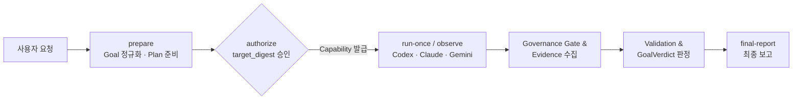

# VibeMarshal

**[한국어](README.md)** | [English](README.en.md)

**VibeMarshal**은 큰 개발 요청을 검증 가능한 목표 계약(`GoalContractRevision`)과 의존성 기반 작업 그래프(`Task DAG`)로 정규화하고, AI 에이전트 작업의 계획·실행·관측·검증·복구를 단일 로컬 SQLite 원장(schema 4)에서 결정적으로 추적하는 **로컬 워크플로 오케스트레이터(Workflow Orchestrator)**입니다.

제품명은 **VibeMarshal**이며, Python 패키지와 CLI의 기술 식별자는 `FlowMarshal`, `flowmarshal-engine`입니다.

> [!NOTE]
> **개발 및 릴리스 상태 (`0.2.0a1` 프리릴리스 / 1.0 판정 `NO-GO`)**
> - **구현 완료 범위:** 사용자 CLI 파사드(`flowmarshal-engine`), SQLite schema 4 단일 원장, `RuntimeJob` 수명주기 관리, 3대 런타임 프로바이더(`codex`, `claude`, `gemini` 및 Antigravity `agy_gemini_bridge.py`), `agent-governance-suite` 워크플로 게이트, 그리고 데스크톱 GUI(`apps/desktop`)용 로컬 HTTP/SSE 엔진 API(`http_api.py`) 연동이 구현되어 있습니다.
> - **1.0 정식 승격 경계:** 1.0 필수 자격 검증(역할 48회, Planning 18회, 실제 요청 E2E 캠페인, 깨끗한 설치 검증, 2개 독립 최종 감사 결정적 join)이 아직 끝나지 않았으므로 공식 1.0 릴리스 판정은 **NO-GO**입니다. `apps/desktop` GUI는 로컬 HTTP 엔진 연결과 합성 Mock 모드를 모두 지원하지만 1.0 필수 판정 경로와는 분리되어 있습니다.

---

## 무엇을 해결하나

VibeMarshal은 에이전트의 일방적인 완료 선언이나 암묵적 상태 변경에 의존하지 않고, **명시적 계약·증거·원장 전이**로 개발 작업을 통제합니다.

- **목표 계약 정규화 및 독립 검토:** 사용자 요청을 `GoalContractRevision`(Hard AC, 제약, 비목표, 효과 정책)으로 정규화하고 독립 검토 결과를 준비 결속(preparation binding)에 남깁니다.
- **Skeleton-first Planning과 Task DAG:** 세부 경로·명령을 고정하기 전에 전략 스켈레톤을 먼저 세우고, 의존성이 있는 실행 가능한 `PlanContractRevision`과 Task DAG를 구성합니다.
- **인간 승인 경계와 자동 계획 활성화:** 사용자는 목표·범위·허용 효과·운영 정책을 `GoalAuthorization`으로 승인하고, Core는 승인된 경계 안에서 적합한 내부 불변 Plan revision을 활성화합니다.
- **적시 명세화(Just-in-time Materialization)와 신선도 검증:** 선행 의존성을 충족해 `ready`가 된 Task만 실행 명세(`TaskExecutionSpecRevision`)로 구체화하며, 실제 효과 직전에 입력 신선도(freshness)와 대상 결속을 재확인합니다.
- **다중 런타임 실행 및 원장 결속:** Codex App Server, Claude Code CLI, Gemini CLI 실행의 intent, receipt, thread/turn binding, provenance가 구분된 사용량과 증거(`EvidenceRecord`)를 SQLite 원장에 남깁니다.
- **증거 기반 완료 판정:** 모델의 자기 완료 선언이 아니라 결정적 검사·의미 검증(`ValidationResult`)과 `GoalVerdict`로만 Task 및 Goal 완료 여부를 결정합니다.
- **관측 우선(Observe-first) 복구와 제한된 재계획:** 중단·재개·실패 분류·제한된 복구/재계획을 원장 상태와 직접 증거에 따라 처리합니다.



현재 권위 구현은 `flowmarshal.engine`입니다. 과거 R1~R3.1 및 `threadkeeper` 코드는 감사 가능한 `legacy/prototype` 기준선으로 보존하며 새 Engine의 권위 도메인으로 가져오지 않습니다.

### 핵심 권위 객체

| 권위 객체 | 고정하는 내용 |
|---|---|
| `ProjectProfileRevision` | 프로젝트 장기 목적, 호환성, 기본 validation 및 위험 정책 |
| `GoalContractRevision` | 사용자 원문, 관찰, Hard AC, Soft preference, 제약, 비목표, 효과 정책 및 준비 결속 |
| `StateSnapshot` / `ProjectMapRevision` | Goal에 필요한 사실·증거·신선도 조건과 범위 내 파일·`AGENTS.md`·관측 심볼 색인 |
| `PlanSkeletonCandidate` / `PlanContractRevision` | 전략 스켈레톤 및 Goal·State 결속, Task DAG, AC 연결, 검증·복구 정책, 모델 배정 |
| `TaskExecutionSpecRevision` | `ready` 시점의 경로·심볼·명령·Context Pack·lock·timeout·idempotency·모델 결속 |
| `Attempt` · `EvidenceRecord` · `GoalVerdict` | 실행·검사 시도와 외부 효과 영수증, 관측 근거, 최종 목표 판정 및 실측 비용(`BudgetUsageRecord`) |

---

## 설치

Python 3.10 이상이 필요합니다. 프리릴리스 wheel은 source checkout과 분리된 가상환경에 절대 경로로 설치합니다.

```powershell
python -m venv C:\absolute\flowmarshal-venv
C:\absolute\flowmarshal-venv\Scripts\python.exe -m pip install `
  C:\absolute\dist\flowmarshal_engine-0.2.0a1-py3-none-any.whl
C:\absolute\flowmarshal-venv\Scripts\flowmarshal-engine.exe --help
```

이 예시는 1.0 qualification 완료를 뜻하지 않습니다. wheel 경계와 고정 의존성은 [Engine 설치 계약](docs/engine-package-install.md)에서 확인할 수 있습니다.

---

## 기본 워크플로

wheel만 설치한 환경에서도 저장소의 `config/` 파일 없이 바로 시작할 수 있습니다.

### 1단계: 역할 설정 및 프로젝트 초기화

상태 경로와 관리할 프로젝트 경로를 절대 경로로 정한 뒤, 사용할 프로바이더의 모델 인벤토리(기본 Codex의 `model/list` 또는 Claude/Gemini 카탈로그)에 있는 `model`/`effort`로 역할 설정을 생성합니다.

```powershell
$ProjectRoot = (Resolve-Path "C:\path\to\my-project").Path
$StateRoot = (New-Item -ItemType Directory -Force (Join-Path $ProjectRoot ".flowmarshal-engine")).FullName
$Database = Join-Path $StateRoot "flowmarshal-engine.sqlite3"
$Artifacts = Join-Path $StateRoot "artifacts"
$RoleConfig = Join-Path $StateRoot "roles.json"
$VibeMarshal = "C:\absolute\flowmarshal-venv\Scripts\flowmarshal-engine.exe"

& $VibeMarshal config init `
  --output $RoleConfig `
  --model "<model-id>" `
  --effort high

& $VibeMarshal --db $Database --artifacts $Artifacts project init `
  --name "my-project" `
  --root $ProjectRoot
```

- `config init`은 지정한 값을 7개 역할(`goal_normalizer`, `goal_reviewer`, `planner`, `general_reviewer`, `critical_reviewer`, `worker`, `validator`)에 적용하고, 파일을 쓰기 전에 현재 모델 인벤토리와 대조합니다.
- 특정 역할만 다르게 지정하려면 `--role "validator=<model-id>:<effort>"`를 덧붙입니다. 기존 파일은 덮어쓰지 않으며, 패키지는 특정 모델을 범용 기본값으로 강제하지 않습니다.

### 2단계: 목표 준비(`prepare`), 승인(`authorize`), 첫 스케줄러 틱(`run-once`)

`project init`이 출력한 `project_id`로 요청을 준비하고 승인한 뒤 첫 스케줄러 틱을 실행합니다.

```powershell
& $VibeMarshal --db $Database --artifacts $Artifacts prepare `
  --project-id <project-id> `
  --request "두 모듈을 수정하고 회귀 테스트까지 실행해 주세요." `
  --role-config $RoleConfig

& $VibeMarshal --db $Database --artifacts $Artifacts authorize `
  --project-id <project-id>

& $VibeMarshal --db $Database --artifacts $Artifacts run-once `
  --project-id <project-id> `
  --role-config $RoleConfig
```

> [!IMPORTANT]
> **대화형 승인 경계 (`TrustedConsoleHost` & `target_digest`)**
> - 설치된 `flowmarshal-engine` 명령은 `TrustedConsoleHost`를 통해 승인 대상을 표시합니다.
> - `authorize`는 현재 Goal과 `project_root`, Core가 실제 활성화할 선택 Plan의 identity·revision·definition/activation digest, 효과 정책, 운영 정책, budget 정책 및 전체 **`target_digest`**를 화면에 출력합니다.
> - 대화형 콘솔에서 **출력된 `target_digest` 전체 문자열을 그대로 입력**해야만 같은 호스트 프로세스의 `ApplicationAuthority`가 일회성 capability를 발급합니다. 사용자는 내부 Plan ID나 개별 계획 digest를 따로 조합할 필요가 없습니다.
> - Core는 기록 직전에 선택 Plan을 포함한 최신 대상을 다시 계산하므로, 다른 입력·EOF·비대화형 실행·표시 후 Goal/root/policy/Plan 변경이 감지되면 승인 기록 없이 즉시 중단됩니다. `--source`는 감사 표식일 뿐 승인 권한이 아닙니다.
> - 이 프로세스 내부 경계는 악의적인 동일 프로세스 코드를 격리하지 않으며, OS 또는 브로커 격리가 없는 동일 사용자 서브프로세스의 raw SQLite 직접 쓰기도 1.0 known limitation입니다. 상세 경계는 [승인 계약 D02](docs/redesign-1.0-contract.md)를 따릅니다.

### 3단계: 상태 관측(`observe` / `status`) 및 최종 보고(`final-report`)

`run-once`는 한 번의 상태 전이 또는 `RuntimeJob` 예약·관측만 수행하고 즉시 반환합니다. 다음 틱은 `status`부터 확인하고, 활성 프로바이더 작업이 있으면 `observe`를 호출합니다.

```powershell
& $VibeMarshal --db $Database --artifacts $Artifacts status --project-id <project-id>
& $VibeMarshal --db $Database --artifacts $Artifacts observe --project-id <project-id>
& $VibeMarshal --db $Database --artifacts $Artifacts run-once --project-id <project-id> --role-config $RoleConfig
& $VibeMarshal --db $Database --artifacts $Artifacts final-report --project-id <project-id> --format markdown
```

- `GoalVerdict`가 확정될 때까지 필요한 틱 수는 Plan과 원장 상태에 따라 달라집니다.
- 반복 실행과 observe-first 복구는 [Engine 사용자 workflow](docs/engine-user-workflow.md)를 따르며, 실패 뒤 자동 복구 범위와 `status`의 `recovery` 읽는 법은 같은 문서의 [자동 복구 읽기](docs/engine-user-workflow.md#자동-복구-읽기)에 정리되어 있습니다.
- 관측 토큰 정책은 선택 사항입니다. `project budget set`에 넘기는 정책은 사용자가 별도 파일로 관리하며, 측정된 토큰을 기준으로 한 best-effort 중단 정책일 뿐 요금이나 구독 한도 상한이 아닙니다. `call_reservation_tokens`는 deprecated 호환 필드이며 admission 계산에 쓰지 않습니다.

---

## 사용자 CLI

### 최상위 파사드 및 거버넌스 명령

| 명령 | 역할 |
|---|---|
| `config init` | 명시한 `model`/`effort`를 인벤토리에 대조하고 사용자 소유 역할 설정 JSON 생성 |
| `prepare` | 요청 정규화, 독립 Goal 검토와 Skeleton-first Planning 준비 |
| `revise` | 준비 단계의 피드백·제약 보완을 반영해 Goal/Plan 후보를 갱신 |
| `authorize` | 목표 범위와 운영 정책을 대화형 `target_digest`로 승인하고 적합한 Plan 활성화 |
| `run-once` | 유계 스케줄러 틱(bounded scheduler tick) 한 번 수행 |
| `observe` | 활성 프로바이더 `RuntimeJob` 관측 및 영수증·터미널 상태 반영 |
| `pause` | 현재 Goal 워크플로 일시정지 |
| `cancel` | 현재 Goal 워크플로 취소 |
| `replan` | 실행 중 보호 규칙을 지키며 실패·변경 조건에 대해 재계획 수행 |
| `status` | Core, control, active job 및 recovery 상태 조회 |
| `final-report` | `GoalVerdict`와 검증 증거·사용량에 근거한 최종 보고 출력 |
| `governance check-plugin` | `agent-governance-suite` 플러그인 적합성(conformance) 사전 검사 수행 |

`project`, `model`, `goal`, `plan`, `task`, `run`, `attempt`, `validate`, `recover`, `report` 아래에는 진단과 세부 운영을 위한 중첩 명령이 있습니다. 전체 목록은 `flowmarshal-engine --help`와 각 명령의 `--help`에서 확인할 수 있습니다.

---

## 런타임 프로바이더 (Codex · Claude · Gemini)

역할·Worker 호출 프로바이더의 기본값은 **Codex App Server**이며, 전역 옵션으로 **Claude Code CLI**(`--provider claude`)와 **Gemini CLI**(`--provider gemini`)를 선택할 수 있습니다. **프로바이더 간 자동 fallback은 절대 수행하지 않으며(fail-closed)**, 프로바이더 옵션은 하위 명령 앞에 두는 전역 옵션입니다.

| 프로바이더 | 전역 선택 플래그 | 모델 카탈로그 / 인벤토리 | 실행 바이너리 옵션 | 비고 |
|---|---|---|---|---|
| **Codex App Server** *(기본)* | `--provider codex` *(생략 가능)* | Codex `model/list` 실시간 조회 | `--codex-bin` *(선택)* | `:danger-full-access` / `approval_policy=never` 확인 |
| **Claude Code CLI** | `--provider claude` | `--claude-model-catalog <json>` *(필수)* | `--claude-bin <exe>` | `--safe-mode` 격리 실행, shim(`.cmd`/`.bat`/`.ps1`) 거부 |
| **Gemini CLI / Antigravity** | `--provider gemini` | `--gemini-model-catalog <json>` *(필수)* | `--gemini-bin <exe\|py>` | 표준 Gemini CLI 및 `agy_gemini_bridge.py`(`agy.exe`) 지원 |

### 1. Claude Code 런타임 프로바이더 (`--provider claude`)

Claude Code CLI를 쓰려면 `--provider claude`와 모델/추론 수준 카탈로그를 명시합니다.

```powershell
flowmarshal-engine --provider claude `
  --claude-model-catalog D:\config\claude-model-catalog.json `
  --claude-bin C:\Users\<사용자>\.local\bin\claude.exe `
  <명령> ...
```

- **카탈로그 결속:** 카탈로그(`flowmarshal-claude-model-catalog-v1`)는 `model/list`를 대신하는 사용자 설정이며 원장에 `configured_catalog` 및 파일 SHA-256으로 결속됩니다. 예시는 [`config/claude-model-catalog.json`](config/claude-model-catalog.json), 역할 예시는 [`config/qualification-roles.claude.json`](config/qualification-roles.claude.json)입니다.
- **실행 파일 잠금:** `--claude-bin`에는 실제 실행 파일을 줍니다. `.cmd`·`.bat`·`.ps1` shim은 거부합니다. 실행 파일 digest와 `claude --version` 값을 잠그므로 CLI를 업데이트하면 새 바인딩이 필요합니다.
- **세션 격리:** 자식 세션은 `--safe-mode`로 실행해 `CLAUDE.md`·auto-memory·plugins·hooks·MCP를 상속하지 않습니다. 프로젝트 `AGENTS.md`는 Engine이 Context로 직접 주입합니다.
- **권한 및 관측 출처:** `:danger-full-access`/`never`는 Claude의 `bypassPermissions` 관측에서 도출한 로컬 대응값이며, 도구 거부(`permission_denials`)가 있는 턴은 실패로 처리합니다. stream 응답에는 effort가 없으므로 CLI가 저장한 세션 기록의 해당 턴 assistant 줄이 model·effort 한 쌍을 명시한 경우에만 `claude_session_transcript` 출처로 기록하고, 아니면 비워 둡니다. 세부 규칙은 [재설계 문서 7.2](docs/orchestration-redesign.md#72-claude-code-runtime-provider)를 따릅니다.

### 2. Gemini CLI 및 Antigravity 브리지 프로바이더 (`--provider gemini`)

Gemini CLI 또는 Antigravity 로컬 실행기(`agy.exe` 브리지)를 쓰려면 `--provider gemini`와 모델 카탈로그(`flowmarshal-gemini-model-catalog-v1`)를 명시합니다.

```powershell
# 표준 Gemini CLI 실행 파일 사용 시
flowmarshal-engine --provider gemini `
  --gemini-model-catalog config\gemini-model-catalog.json `
  --gemini-bin C:\path\to\gemini.exe `
  <명령> ...

# Antigravity (agy.exe) 브리지 사용 시
flowmarshal-engine --provider gemini `
  --gemini-model-catalog config\gemini-model-catalog.json `
  --gemini-bin src\flowmarshal\engine\agy_gemini_bridge.py `
  <명령> ...
```

- **카탈로그 및 역할 예시:** 카탈로그 예시는 [`config/gemini-model-catalog.json`](config/gemini-model-catalog.json), 역할 설정 예시는 [`config/qualification-roles.gemini.json`](config/qualification-roles.gemini.json)에 있습니다. 실행 도중 카탈로그 파일의 SHA-256이 바뀌면 `RUNTIME_PROVIDER_CATALOG_CHANGED`로 차단합니다.
- **stream-json 관측 및 지연 시간 집계:** `GeminiRuntime`([`src/flowmarshal/engine/gemini_runtime.py`](src/flowmarshal/engine/gemini_runtime.py))은 `--output-format stream-json` 이벤트를 파싱하여 세션 ID, 응답 본문, 토큰 사용량과 `duration_ms`(`latency_ms`)를 원장에 결속합니다.
- **Antigravity 브리지(`agy_gemini_bridge.py`):** 로컬 Antigravity IDE/CLI(`agy.exe`, 기본 경로 또는 `FLOWMARSHAL_AGY_EXE` 환경변수)를 통해 Gemini 모델을 구동할 수 있습니다. 외부 `FLOWMARSHAL_GOVERNANCE_*` 환경변수가 설정되지 않은 상태에서 `agy_gemini_bridge.py`를 지정하면 로컬 거버넌스 브리지(`AgyLocalGovernance`)가 실행 Task의 스냅샷·게이트 검사를 연결합니다.

---

## agent-governance-suite 필수 연동

활성화 뒤 모든 실행 Task는 `agent-governance-suite` 워크플로 게이트를 거쳐야 dispatch·완료됩니다. 거버넌스 구성이 없으면 `run-once`는 실행 Task를 `GOVERNANCE_GATE_REQUIRED`로 멈춥니다.

```powershell
$env:FLOWMARSHAL_GOVERNANCE_PLUGIN_ROOT = "D:\claude\agent-governance-suite"
$env:FLOWMARSHAL_GOVERNANCE_MODEL_CLASSES = "D:\config\governance-model-classes.json"
flowmarshal-engine --provider claude `
  --claude-model-catalog D:\config\claude-model-catalog.json `
  run-once --project-id <project-id> --role-config <역할 설정>
```

- **A2 프로필 및 런타임 전제조건:** Node 24 이상과 `host-integration.json`이 포함된 플러그인, 그리고 명시적 A2 same-user 프로필 설정 `FLOWMARSHAL_GOVERNANCE_A2_PROFILE`(`flowmarshal-same-user-v1`)이 필요합니다. 설정이 없거나 key·pin·digest·관측이 어긋나면 `run-once`는 실행 Task를 시작하지 않습니다. 호스트 중립 서명 CLI는 더 이상 쓰지 않으며, 보호 VM 서명이나 CLI 서명으로 자동 전환하지 않습니다. A2는 같은 OS 사용자 경계이므로 동일 사용자가 원장·transcript·producer key를 직접 수정하는 것은 막지 못합니다. R16 승인 슬롯은 A2에서 거부되며 1.0 canary 이후 후속 과제입니다. Engine은 플러그인을 특정 commit·버전으로 하드코딩하지 않고 manifest에서 진입점을 찾아 실행 전에 확인합니다.
- **플러그인 적합성 검사 (`governance check-plugin`):** 플러그인을 처음 쓰거나 변경했을 때는 다음 명령으로 먼저 확인합니다.
  ```powershell
  flowmarshal-engine governance check-plugin --plugin-root <플러그인 위치>
  ```
  Engine이 기대하는 플러그인 동작을 임시 폴더에서 끝까지 실행해 항목별 결과를 JSON으로 출력하며, 실패 시 0이 아닌 종료 코드를 반환합니다(프로젝트와 원장은 변경하지 않음). `run-once` 또한 프로젝트마다 처음 보는 플러그인 파일 구성이면 첫 Task 시작 전에 같은 검사를 한 번 자동 실행하며, 통과하지 못하면 `GOVERNANCE_CONTRACT_MISMATCH: conformance:<검사 ID>`로 멈춥니다.
- **모델 등급 대응표 (`FLOWMARSHAL_GOVERNANCE_MODEL_CLASSES`):** Worker·steward로 관측되는 모델 이름마다 플러그인 등급(`lightweight` · `general` · `deep` · `frontier`)을 매핑한 JSON입니다(예: `{"format": "flowmarshal-governance-model-classes-v1", "classes": {"<관측되는 model 이름>": "general"}}`). 표에 없는 모델이 관측되면 즉시 멈추며, 이 값은 사용자 설정 주장으로 기록됩니다.
- **계약 불일치 및 재개:** 플러그인·환경이 맞지 않으면 `run-once`는 `GOVERNANCE_CONTRACT_MISMATCH: <검사 ID>: 기대 …, 관측 …`로 멈추고 Task 상태는 바꾸지 않습니다. 설정을 고친 뒤 다시 `run-once`를 실행하면 같은 자리에서 이어 갑니다(단, 이미 저장된 플러그인 응답 형태 자체가 어긋난 경우에는 같은 Attempt에서 동일 불일치가 재발하는 known limitation이 있습니다).
- **플러그인 트리 다이제스트 및 Git 스냅샷:** Engine은 실행에 쓴 플러그인 파일의 SHA-256과 tree digest를 Task마다 원장에 기록합니다. 대상 프로젝트는 Git 저장소 루트여야 하며, Engine은 작업 트리를 임시 index로 스냅샷 commit에 담아 비교하므로 사용자의 `HEAD`·브랜치·index·작업 파일은 바꾸지 않습니다. `.git`에는 스냅샷 객체와 `refs/flowmarshal/governance/...` ref가 남으며, 감사가 끝나 정리하려면 `git for-each-ref --format="%(refname)" refs/flowmarshal/governance`로 조회해 `git update-ref -d <ref>`로 삭제할 수 있습니다.
- **사용자 미커밋 변경 보호 (`GOVERNANCE_USER_CHANGE_OVERLAP`):** Task의 쓰기 대상 파일에 현재 Goal의 선행 작업이 만들지 않은 미커밋 변경(Goal 시작 전부터 있던 변경이나 도중 사용자가 직접 고친 내용)이 있으면 Task 시작 전에 `GOVERNANCE_USER_CHANGE_OVERLAP`으로 멈춥니다.
- **판단 보조(steward) 및 프로바이더 제약:** 판단 보조는 역할 설정의 `general_reviewer`·`critical_reviewer` 모델을 쓰며 Task마다 추가 호출이 발생합니다. 기본 Codex 프로바이더에서는 턴별 model·effort 관측 근거가 아직 없어 `GOVERNANCE_PROVIDER_UNSUPPORTED`로 멈춥니다. `attempt retry`는 Task를 다시 열기만 하고 `validate task --complete`는 받지 않으며, 재시도와 완료는 반드시 `run-once`가 게이트를 거쳐 처리합니다.

세부 규칙은 [재설계 문서 9.1](docs/orchestration-redesign.md#91-agent-governance-suite-필수-gate)에 있습니다.

---

## 데스크톱 GUI 및 로컬 HTTP API

`apps/desktop`에는 워크플로 상태·Goal·Plan·Task DAG·실행 이벤트를 시각적으로 조회하고 조작할 수 있는 React/TypeScript 기반 대시보드가 포함되어 있습니다. Node 24 이상(`package.json`의 `engines.node`)과 `pnpm@11.19.0`을 사용합니다.

### 1. 프론트엔드 실행 (`apps/desktop`)

```powershell
cd apps\desktop
pnpm install
pnpm dev
```

### 2. 두 가지 런타임 모드 (`Mock` ↔ `Local HTTP Engine`)

데스크톱 GUI는 상단 헤더의 런타임 전환 스위치 또는 URL 쿼리 파라미터(`?runtime=http`)를 통해 두 가지 모드를 지원합니다.

1. **합성 Mock 모드 (`MockEngineClient`):** 별도 백엔드 없이 합성 스냅샷으로 전체 화면 흐름과 UX를 즉시 시험할 수 있습니다.
2. **로컬 HTTP Engine 모드 (`HttpEngineClient` + `http_api.py`):** 로컬 Python HTTP/SSE 어댑터 서버를 띄워 실제 SQLite 원장(`SQLiteEngineLedger`), `EngineService`, `EngineApplication`과 실시간으로 연동합니다.

```powershell
# 로컬 HTTP 엔진 API 서버 기동 (기본 포트 8765)
.\.venv\Scripts\python.exe -m flowmarshal.engine.http_api --port 8765

# 실제 Antigravity Gemini 런타임과 연동하여 기동할 때
.\.venv\Scripts\python.exe -m flowmarshal.engine.http_api --port 8765 --live-gemini
```

- **권위 경계:** 브라우저 GUI는 SQLite 원장을 직접 열거나 상태를 자체 판정하지 않고, 오직 `http_api.py`의 `/api/v1/snapshot`, `/api/v1/events`(SSE) 및 액션 엔드포인트를 통해 Core 원장 상태를 관측·요청합니다. 화면과 Engine 연결 경계는 [GUI 인터페이스 설계](docs/gui-interface-design.md)에 정리되어 있습니다.

---

## 데이터와 안전 경계

별도 `--db`, `--artifacts` 옵션을 주지 않으면 CLI를 실행한 현재 작업 디렉터리 아래에 저장합니다.

```text
.flowmarshal-engine/flowmarshal-engine.sqlite3
.flowmarshal-engine/artifacts/
```

- **Schema 4 단일 원장:** Engine writer는 schema 4의 새 DB만 생성하며, 과거 schema 3 원장과 raw receipt/history는 제품 런타임과 분리된 read-only inspector로만 엽니다. 기존 프로토타입이나 운영 DB를 제자리 마이그레이션(in-place migration)하지 않습니다.
- **입력 신선도 강제 (`STALE_EXECUTION_INPUT`):** 실행 명세(`TaskExecutionSpecRevision`) 구체화 이후 State·Project Map·대상 파일·Context digest가 바뀌면 `STALE_EXECUTION_INPUT`으로 실행을 즉시 중단하며, 오래된 입력을 묵시적으로 재승인하거나 실행하지 않습니다.
- **외부 효과 멱등성 및 관측 우선:** 결과가 불명확한 외부 intent는 자동으로 재실행하지 않고 기존 바인딩과 프로바이더 상태를 먼저 관측합니다. 프로바이더 턴의 종료(terminal)만으로 외부 효과 완료를 선언하지 않으며, typed adapter receipt와 대상 재관측을 모두 확인합니다.
- **직렬 실행 및 증거 검증:** 동일 프로젝트의 Attempt는 qualification 완료 전까지 직렬로 실행하며, 필수 `EvidenceRecord`와 독립 검증(`ValidationResult`)을 통과해야만 Task와 Goal을 완료할 수 있습니다.

세부 권위와 불변조건은 [전면 재설계 문서](docs/orchestration-redesign.md)와 [1.0 계약](docs/redesign-1.0-contract.md)에 정의되어 있습니다.

---

## 개발과 검증

저장소의 개발·평가 모듈까지 검사하려면 사용자 설치와 분리된 개발 환경에 editable 모드로 설치합니다.

```powershell
.\.venv\Scripts\python.exe -m pip install -e .
.\.venv\Scripts\python.exe -m compileall -q src tests
.\.venv\Scripts\python.exe -m unittest discover -s tests -p 'test_engine*.py' -v
.\.venv\Scripts\python.exe -m flowmarshal.engine.smoke --project-root <project-root>
.\.venv\Scripts\python.exe -m pip check
```

이 검사는 로컬 개발 확인용입니다. 실제 역할 48회, Planning 18회, 실제 요청 E2E 캠페인, 깨끗한 wheel 설치 검증과 2개 독립 최종 감사까지 모두 통과해야 1.0으로 승격합니다. 상세 실행 계약은 [Engine qualification](docs/engine-qualification.md)을 따릅니다.

---

## 문서

| 문서 | 내용 |
|---|---|
| [전면 재설계](docs/orchestration-redesign.md) | 제품 목적, 권위 구조, 3대 프로바이더 및 거버넌스 게이트 설계 |
| [1.0 계약](docs/redesign-1.0-contract.md) | 1.0 수용 기준, 승인 경계(D02)와 필수 검증 |
| [Engine cutover ADR](docs/engine-cutover-adr.md) | legacy 분리와 1.0 전환 아키텍처 결정 |
| [사용자 워크플로](docs/engine-user-workflow.md) | 반복 실행, observe-first 복구 및 `status` 해석 가이드 |
| [설치 계약](docs/engine-package-install.md) | wheel 패키징, 의존성, schema 경계 |
| [Engine qualification](docs/engine-qualification.md) | 1.0 승격을 위한 캠페인 및 검증 절차 |
| [GUI 인터페이스 설계](docs/gui-interface-design.md) | 데스크톱 대시보드 화면 구조와 Engine 연결 경계 |
| [문서 지도](docs/README.md) | 전체 문서와 역사적 근거 색인 |

---

## 코드 지도

| 영역 | 경로 |
|---|---|
| 권위 스키마와 불변조건 | [`src/flowmarshal/engine/domain.py`](src/flowmarshal/engine/domain.py) |
| SQLite 원장과 History | [`src/flowmarshal/engine/ledger.py`](src/flowmarshal/engine/ledger.py) |
| Goal 정규화와 검토 | [`src/flowmarshal/engine/goal.py`](src/flowmarshal/engine/goal.py) |
| Project Map과 Context Pack | [`src/flowmarshal/engine/context.py`](src/flowmarshal/engine/context.py) |
| Skeleton-first Planning | [`src/flowmarshal/engine/planning.py`](src/flowmarshal/engine/planning.py) |
| 응용 파사드와 권한 경계 | [`src/flowmarshal/engine/application.py`](src/flowmarshal/engine/application.py) |
| RuntimeJob과 Codex 어댑터 | [`src/flowmarshal/engine/runtime.py`](src/flowmarshal/engine/runtime.py) |
| 프로바이더 라우팅 (`codex`/`claude`/`gemini`) | [`src/flowmarshal/engine/providers.py`](src/flowmarshal/engine/providers.py) |
| Claude Code 런타임 어댑터 | [`src/flowmarshal/engine/claude_runtime.py`](src/flowmarshal/engine/claude_runtime.py) |
| Gemini CLI 런타임 어댑터 및 Antigravity 브리지 | [`src/flowmarshal/engine/gemini_runtime.py`](src/flowmarshal/engine/gemini_runtime.py), [`src/flowmarshal/engine/agy_gemini_bridge.py`](src/flowmarshal/engine/agy_gemini_bridge.py) |
| `agent-governance-suite` 워크플로 게이트 | [`src/flowmarshal/engine/governance_gate.py`](src/flowmarshal/engine/governance_gate.py) |
| 서비스와 상태 전이 | [`src/flowmarshal/engine/service.py`](src/flowmarshal/engine/service.py) |
| 로컬 HTTP/SSE GUI 백엔드 API | [`src/flowmarshal/engine/http_api.py`](src/flowmarshal/engine/http_api.py) |
| 사용자 CLI와 최종 보고 | [`src/flowmarshal/engine/cli.py`](src/flowmarshal/engine/cli.py), [`src/flowmarshal/engine/reporting.py`](src/flowmarshal/engine/reporting.py) |
| 데스크톱 GUI 클라이언트 | [`apps/desktop`](apps/desktop) |

---

## 라이선스

VibeMarshal은 Apache License 2.0으로 배포합니다. 자세한 내용은 [LICENSE](LICENSE)와 [NOTICE](NOTICE)를 참고하세요.
